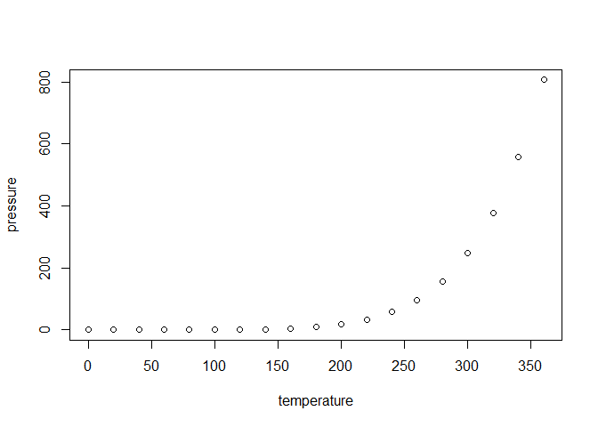

<!-- README.md is generated from README.Rmd. Please edit that file -->

# assignmentB2KodiakBear

<!-- badges: start -->

<!-- badges: end -->

The goal of assignmentB2KodiakBear is to assist users in counting
missing values for all columns by group

## Installation

You can install this package directly by calling
`devtools::install_github("UBC-STAT545-F2026/assignmentB2KodiakBear")`

``` r
devtools::install_github("UBC-STAT545-F2026/assignmentB2KodiakBear")
```

## Example

This example computes the number of missing values in the `airquality`
dataset grouped by the `cyl` column.

``` r
##library(assignmentB2KodiakBear)
##count_all_missing_by_group(airquality, Month)
```

This example has the same output as the last example, but shows off an
alternative way of invoking the `count_all_missing_by_group()`: piping
the dataset into the function.

``` r
##library(assignmentB2KodiakBear)
##airquality |> count_all_missing_by_group(Month) 
```

The optional `.groups` argument allows us to keep the output grouped by
the grouping column. See example below; notice how the output is a
grouped tibble, rather than the ungrouped tibble output of the earlier
examples.

``` r
##count_all_missing_by_group(airquality, Month, .groups = "keep")
```

What is special about using `README.Rmd` instead of just `README.md`?
You can include R chunks like so:

``` r
summary(cars)
#>      speed           dist       
#>  Min.   : 4.0   Min.   :  2.00  
#>  1st Qu.:12.0   1st Qu.: 26.00  
#>  Median :15.0   Median : 36.00  
#>  Mean   :15.4   Mean   : 42.98  
#>  3rd Qu.:19.0   3rd Qu.: 56.00  
#>  Max.   :25.0   Max.   :120.00
```

You’ll still need to render `README.Rmd` regularly, to keep `README.md`
up-to-date. `devtools::build_readme()` is handy for this.

You can also embed plots, for example:



In that case, don’t forget to commit and push the resulting figure
files, so they display on GitHub and CRAN.
